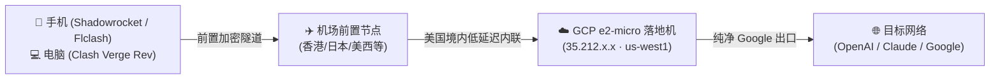

# 🚀 GCP 永久免费机 (Always Free) + 链式加速落地节点实战全指南

> 从 0 到 1 打造极速、纯净 Google IP、免遭账单反噬的永久免费代理中转方案。  
> 兼容 **PC（Clash Verge Rev）** 与 **移动端（Shadowrocket 小火箭 / Flclash）**。

---

## 🌟 方案核心优势

1. **绝对纯净的 Google 官方原生 IP**：
   * 完美解锁 ChatGPT、Claude、Google Gemini 等苛刻 AI 平台，告别 Cloudflare 盾和机器人验证码。
2. **0 元白嫖，坚决防反噬**：
   * 严格遵循 Google Cloud Always Free（永久免费）标准。
   * 配置**出站防火墙（防 CDN 扫盘爆流量）**与 **$1 预算硬预警**。
3. **链式中转（机场前置 -> GCP 落地）**：
   * 破除 GCP 廉价 Standard 线路直连国内的高延迟与丢包。
   * 流量路径：`本地设备 -> 机场高速节点 -> GCP 美西机房 -> 目标网站`。
   * 节点间（美西机场出口 -> GCP 俄勒冈）延迟仅 10~30ms，端到端延迟低至 180ms，真绿延迟。

---

## 🏗️ 架构拓扑图



---

## 🛡️ 第一部分：GCP 免费实例创建与防反噬设置

### 1. 实例规格要求（严格对照）
* **机型**：`e2-micro`（2 vCPU，1 GB 内存）
* **区域 (Zone)**：仅限以下三个区域之一（必须完全符合）：
  * `us-west1`（俄勒冈，推荐，离亚太最近）
  * `us-central1`（爱荷华）
  * `us-east1`（南卡罗来纳）
* **系统盘**：30 GB 标准永久性磁盘（Standard persistent disk，勿选 SSD/Balanced）
* **操作系统**：Debian 12 或 Ubuntu 22.04 LTS
* **网络服务层级**：**标准 (Standard)**（切勿选择 Premium 优质层级，标准层级才有免费额度）
* **外部 IP**：临时 (Ephemeral) 即可，不要保留闲置未附加的静态 IP（闲置收费）。

### 2. 避免“被反噬”的防火墙安全策略
很多教程教完就走，导致很多小伙伴被 GFW 探测器狂刷 GCP 免费流量出站，产生天价 CDN 账单。必须在 GCP 防火墙中做好防护：

#### ① 入站放行节点端口
在 GCP VPC 网络 -> 防火墙规则 -> 创建规则：
* **名称**：`allow-vmess-proxy`
* **方向**：入站 (Ingress)
* **目标**：网络中的所有实例
* **来源 IPv4 范围**：`0.0.0.0/0`
* **协议与端口**：TCP 指定端口 `8443`

#### ② 出站拦截 CDN 偷跑流量（关键防护）
* **名称**：`deny-cdn-egress-custom`
* **方向**：出站 (Egress)
* **操作**：拒绝 (Deny)
* **目标**：网络中的所有实例
* **目标 IPv4 范围**：拦截常见的 CDN IP 网段（例如 Fastly、Akamai 等常见刷流量回源网段）。
* **协议与端口**：全部允许阻断。

#### ③ 设置 $1 预算预警
在 GCP Billing（结算）-> 预算与提醒 -> 创建预算：
* 目标金额设为 **$1.00**
* 触发阈值：50%、90%、100% 触发邮件告警。一旦有任何扣费，手机第一时间收到通知。

---

## ⚙️ 第二部分：小鸡服务端配置（VMess + WebSocket）

经过深度实测，**VLESS-Reality 嵌套在二级链式代理中，极易发生 ClientHello/SNI 损毁与阻断**。最佳、最稳定、多端通用的方案是：**纯净 VMess + WebSocket**。

### 1. 安装 Xray
在 GCP 实例中执行：
```bash
bash -c "$(curl -L https://github.com/XTLS/Xray-install/raw/main/install-release.sh)" @ install
```

### 2. 配置 `/usr/local/etc/xray/config.json`
```json
{
  "log": {
    "loglevel": "warning"
  },
  "inbounds": [
    {
      "port": 8443,
      "protocol": "vmess",
      "settings": {
        "clients": [
          {
            "id": "你的UUID填在这里",
            "alterId": 0
          }
        ]
      },
      "streamSettings": {
        "network": "ws",
        "wsSettings": {
          "path": "/gcp-ws"
        }
      }
    }
  ],
  "outbounds": [
    {
      "protocol": "freedom"
    }
  ]
}
```

### 3. 启动并开机自启
```bash
sudo systemctl restart xray
sudo systemctl enable xray
```

---

## 💻 第三部分：客户端配置

### 1. 电脑端：Clash Verge Rev（Mihomo 内核）
在 Clash 配置文件的 `proxies:` 列表中加入 GCP 落地节点，并使用 `dialer-proxy` 指向你的机场节点：

```yaml
proxies:
  # 1. 你的前置节点（机场提供的现有节点，支持 Shadowsocks / VMess / Trojan / SOCKS5）
  - name: 🇺🇸 美国硅谷前置
    type: socks5
    server: 机场服务器域名或IP
    port: 443
    # ... 认证参数 ...

  # 2. GCP 链式落地节点
  - name: "🚀 GCP-链式加速"
    type: vmess
    server: 35.212.x.x        # 你的 GCP 外部 IP
    port: 8443
    uuid: 你的UUID填在这里
    alterId: 0
    cipher: auto
    network: ws
    ws-opts:
      path: /gcp-ws
    dialer-proxy: "🇺🇸 美国硅谷前置" # 核心：流量先过前置节点
```
在策略组（`proxy-groups`）中，把 `🚀 GCP-链式加速` 加入 `PROXIES` 或规则组，即可实现真绿延迟测速与流畅冲浪！

---

### 2. 手机端：小火箭（Shadowrocket）

#### 第一步：添加节点
使用标准 VMess 格式导入（或直接扫描二维码）：
* **类型**：Vmess
* **服务器**：`你的GCP外部IP`
* **端口**：`8443`
* **UUID**：`你的UUID`
* **混淆方式**：`websocket`
* **路径**：`/gcp-ws`
* **TLS**：**关闭**

#### 第二步：设置链式中转（代理通过）
1. 导入后在列表中找到该节点，点击右侧 **`(i)` 详情图标**。
2. 往下拉，点击 **「代理通过」**（*Proxy Through*）。
3. 勾选你的**机场前置节点**，点击右上角保存。

#### 常见坑避坑指南：
> **为什么首页连通性测试显示“超时”，但实际能秒开网页且落地 IP 是对的？**  
> 小火箭首页测速默认是 **TCP 直连测速**，它不会走“代理通过”，直接连 GCP 被国内墙拦截所以报超时。  
> **解决办法**：去小火箭 **设置 -> 连通性测试 -> 测试方法 -> 改为 HTTP**，测速即可显示正常的绿色真实延迟！

---

### 3. 手机端：Flclash
* Flclash 采用与电脑完全一致的 Mihomo 内核。
* 直接将电脑端配好的 `.yaml` 配置文件通过微信/AirDrop 发送到手机。
* 选择“用 Flclash 打开导入”，开箱即用，无需任何二次繁琐配置。

---

## ❓ 常见问答 FAQ

**Q：前置代理选 SOCKS5 还是 HTTP？**  
**A**：无脑首选 **SOCKS5**。SOCKS5 在传输层直接转发纯二进制数据流，握手极快、开销最小、完全不篡改报文，且支持 UDP。

**Q：为什么不推荐 VLESS-Reality 做链式代理？**  
**A**：Reality 依赖在 TLS ClientHello 阶段伪装指定大厂域名的证书握手。当它被包裹进第二层代理隧道（`dialer-proxy`）时，TLS 报文嵌套极易出现兼容性阻断或握手认证失败，排查极为痛苦。而 VMess+WS 是天生契合多层隧道嵌套的完美方案。

---

## 📄 License
MIT © 2026. 欢迎自由 Fork 与分享！若有收获请给个 Star ⭐️！
